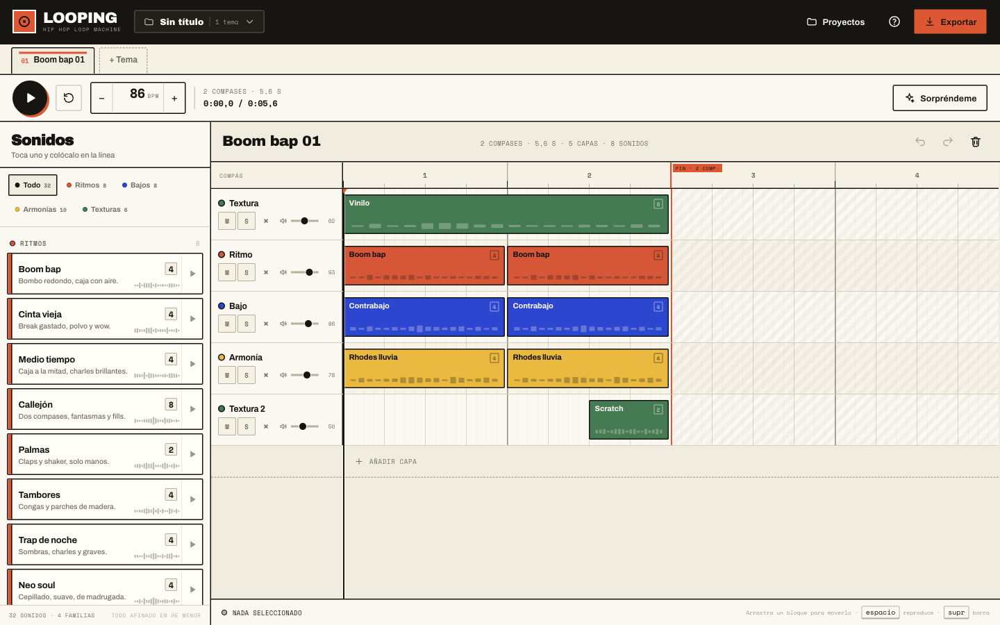
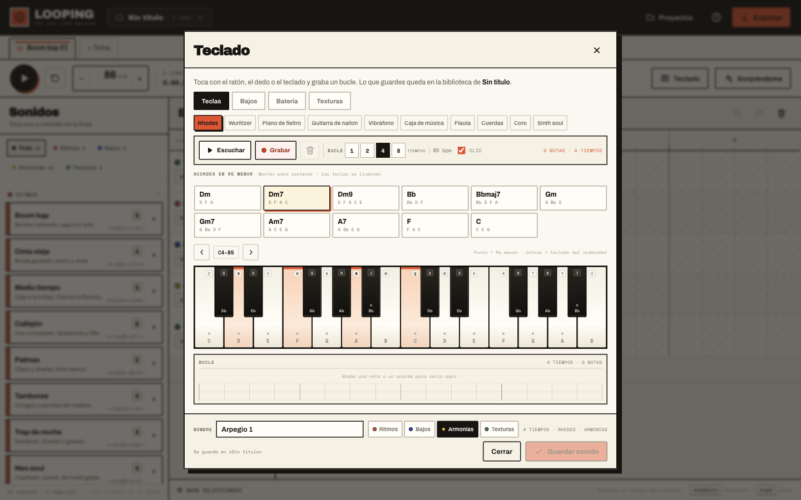

# Looping

**Web:** <https://fraguio.com/looping/> · <https://jfraguio.github.io/looping/>

**Máquina de bases de hip hop en el navegador.** Elige sonidos, colócalos en capas, escucha el bucle cambiar en directo y expórtalo en MP3 o WAV. Sin cuentas, sin servidor y sin samples: cada sonido se sintetiza en tu equipo.



> Una vuelta de tuerca a la idea de [sen](https://github.com/jfraguio/sen): misma obsesión por el sonido y el detalle, otra piel y otro propósito.

## Publicado

La aplicación está publicada con **GitHub Pages** desde la rama `main`, carpeta raíz:

- <https://fraguio.com/looping/>
- <https://jfraguio.github.io/looping/> (redirige al dominio anterior)

Cada push a `main` publica una versión nueva automáticamente.

## Arrancar en local

No hay que compilar. Desde la raíz del repositorio:

```bash
python3 -m http.server 4174 --bind 127.0.0.1
```

o, si tienes Node:

```bash
npm start
```

Abre **<http://127.0.0.1:4174/>**. No abras `index.html` con `file://`: los módulos ES y el audio necesitan un servidor.

El proyecto incluye `.nojekyll` y todas las rutas son relativas, así que funciona en la raíz de un dominio o en un subdirectorio (`usuario.github.io/repositorio/`).

## Cómo se usa

1. **Elige un sonido** en la biblioteca. Al tocarlo se escucha y queda seleccionado.
2. **Toca una capa** de la línea de tiempo en el tiempo donde quieras colocarlo. La barra naranja te recuerda que estás colocando; pulsa **Listo** para salir.
3. **Añade capas** y combina ritmo, bajo, armonía y textura. Cada capa tiene volumen, mute y solo.
4. **Arrastra un bloque** para moverlo. Selecciónalo para **duplicarlo** (útil cuando el sonido dura menos que el bucle) o quitarlo.
5. **Play**. El cabezal recorre la línea y vuelve al principio. La línea dura lo que la capa más larga, redondeado al compás.
6. **Exporta** en MP3 320 kbps o WAV 16 bits, con la duración que quieras (15 s – 5 min) y fundido final opcional.

**Sorpréndeme** crea una base completa y equilibrada al azar. Es la manera más rápida de escuchar el catálogo y luego desmontarlo.

## Teclado y sonidos propios



El botón **Teclado**, junto a Sorpréndeme, abre un estudio para fabricar sonidos:

- Elige una familia (**Teclas, Bajos, Batería, Texturas**) y un instrumento de los que forman el catálogo: Rhodes, Wurlitzer, piano de fieltro, guitarra, vibráfono, flauta, cuerdas, coro, sinth, contrabajo, sub 808, bajos, batería, scratch, voz o campanas.
- Toca las dos octavas de teclas o los pads. La batería usa diez pads; el scratch uno grande.
- También funciona con el **teclado del ordenador**: `Z S X D C V G B H N J M` para la primera octava y `Q 2 W 3 E R 5 T 6 Y 7 U` para la segunda. Las letras aparecen sobre las teclas. En los pads, las teclas `1–0`.
- **Acordes en Re menor** (Dm, Dm7, Dm9, Bb, Bbmaj7, Gm, Gm7, Am7, A7, C, F): al tocarlos se iluminan sus notas en el teclado y puedes sostenerlos para grabarlos.
- Elige la duración del bucle (**1, 2, 4 u 8 tiempos**), pulsa **Grabar** y toca cuando quieras. No hay cuenta atrás: la primera tecla (o pad) marca el inicio y queda en el tiempo 0; si quieres empezar con silencio, pulsa cualquier tecla no musical, como `espacio`, y el reloj arrancará igual. El bucle se repite para que escuches la toma antes de guardarla.
- Ajusta nombre y sección (**Ritmos, Bajos, Armonías o Texturas**) y pulsa **Guardar sonido**. Aparece en la biblioteca de ese álbum, se puede colocar en la línea de tiempo y se comporta como cualquier otro sonido.
- Los sonidos propios **viven en el álbum**: se guardan en `localStorage` y viajan dentro del `.looping.json`. Un álbum nuevo empieza solo con el catálogo original.

En el teclado, las letras `Z–M` y `Q–U` tocan las dos octavas y `1–0` los pads. `espacio` escucha o para el bucle y `⇧R` empieza o para la grabación; al esperar la primera tecla, cualquier tecla arranca el reloj.

## Lo que incluye

- **32 sonidos originales** en cuatro familias: 8 ritmos, 8 bajos, 10 armonías y 6 texturas. Todos comparten la tonalidad de Re menor y están nivelados para combinarse.
- **Teclado para crear sonidos propios**: instrumentos del catálogo, acordes de Re menor, grabación en bucle, pads de batería y guardado por álbum.
- **Línea de tiempo por capas** con bloques de 1, 2, 4 u 8 tiempos, duración dinámica, extensión del bucle, arrastre con imán, duplicado y deshacer.
- **Escucha en directo**: renderiza el bucle en el navegador y hace crossfades de 45 ms al cambiar cualquier cosa. Puedes editar mientras suena.
- **Exportación** MP3 320 kbps con etiquetas ID3 (título, álbum, artista, género) o WAV 44,1 kHz / 16 bits. Se repite el bucle hasta llenar la duración elegida y se aplica un fundido final.
- **Álbumes y temas** con autoguardado en `localStorage`, proyecto exportable/importable en `.looping.json` y gestión de varios álbumes.
- **Interfaz para ratón, teclado y tablet**. La biblioteca se convierte en una hoja inferior en pantallas estrechas.
- **Sin dependencias de interfaz**. Solo JavaScript, CSS y HTML; los módulos de audio se cargan como módulos ES.

## Atajos

| Acción | Tecla |
| --- | --- |
| Reproducir / pausar | `espacio` |
| Borrar el bloque seleccionado | `supr` / `backspace` |
| Duplicar el bloque | `⌘/Ctrl D` |
| Mover el bloque un tiempo | `←` `→` |
| Cambiar el bloque de capa | `↑` `↓` |
| Deshacer / rehacer | `⌘/Ctrl Z` / `⇧⌘/Ctrl Z` |
| Exportar | `⌘/Ctrl E` |
| Guardar proyecto | `⌘/Ctrl S` |
| Ayuda | `?` |
| En el teclado: escuchar / grabar | `espacio` / `⇧R` |
| En el teclado: tocar notas / pads | `Z–M · Q–U` / `1–0` |

## El motor de sonido

No hay samples ni descargas: el catálogo se sintetiza muestra a muestra a **44,1 kHz estéreo**, de forma determinista (misma semilla, mismo resultado). El mismo código que suena en directo genera el archivo exportado.

- **Batería**: bombos con caída de tono, membranas y saturación; cajas con cuerpo modal, ruido de bordón y aire estéreo; charles metálicos con banco de parciales y filtros; congas, shakers, claps, escobillas y platos.
- **Bajos**: cuerdas pulsadas Karplus-Strong con cuerpo de madera, subgraves 808 con saturación, bajos sustractivos con filtro y drive.
- **Armonías**: FM para Rhodes y Wurli; piano de fieltro aditivo con ruido de martillo; guitarra de nailon Karplus; cuerdas y coro por formantes; vibráfono, caja de música, flauta y pads analógicos.
- **Texturas**: vinilo con crujidos deterministas, lluvia, ciudad, scratch por resampleo de un stab, voz cortada por formantes y campanas modales.
- **Espacio**: reverb FDN de ocho líneas por familia, wow/flutter de cinta, saturación suave, limitador de pico y normalización de mezcla por RMS.
- **Catálogo compuesto en Re menor** para que cualquier combinación razonable funcione sin saber armonía.

La mezcla se normaliza a un nivel de escucha consistente y se limita el pico para que la exportación no sature. Los archivos finales quedan alrededor de −14 LUFS.

## Estructura

```
index.html
src/
  audio/
    catalog.js        los 32 sonidos y sus patrones
    studio.js         instrumentos, acordes y sonidos propios
    instruments.js    batería, bajos, teclados, texturas
    dsp.js            filtros, ruido, reverb, cinta, medidas
    rng.js            azar determinista
    engine.js         render de sonidos y mezcla del bucle
    player.js         reproducción en directo y crossfades
    export.js         exportación MP3/WAV
    export-worker.js  codificador MP3 en worker
    wav.js            codificador WAV
  app/
    main.js           interfaz, estado y eventos
    studio.js         estudio de teclado y grabación
    storage.js        álbumes, proyectos y localStorage
    recipes.js        bases de arranque y Sorpréndeme
    dom.js            utilidades y toasts
    modals.js         diálogos y foco
  styles/main.css
assets/fonts/         Archivo, Archivo Black y Space Mono (OFL)
vendor/lame.min.js    codificador MP3 (LGPL)
scripts/              render de pruebas y servidor local
```

## Pruebas y herramientas

El motor funciona igual en Node, sin DOM. Esto permite revisar el catálogo sin abrir el navegador:

```bash
node scripts/render-catalog.mjs 84      # todos los sonidos + demo en tmp/catalog
node scripts/render-recipes.mjs          # las ocho bases de arranque en tmp/recipes
node scripts/test-drums.mjs              # voces de batería aisladas
```

Los WAV se pueden analizar con `ffmpeg`, `ffprobe` o `sox` (nivel, pico, LUFS, espectro). La app se sirve sin caché con `node scripts/serve.mjs 4174`.

## Navegadores

Chrome/Edge 98+, Firefox 114+ y Safari 15.4+ (módulos ES, Web Audio y `localStorage`). En móvil y tablet, el audio necesita un primer toque; la app lo desbloquea con el primer gesto.

## Créditos y licencias

- Motor, catálogo, interfaz y textos originales de este proyecto.
- Tipografías **Archivo** y **Space Mono** bajo SIL Open Font License; las licencias están en `assets/fonts/`.
- **lamejs** (LGPL) se incluye en `vendor/` para codificar MP3 en el navegador; su licencia está en `vendor/lamejs.LICENSE.txt`.
- Inspirado en la arquitectura y las ideas de [sen](https://github.com/jfraguio/sen), de fraguio.
